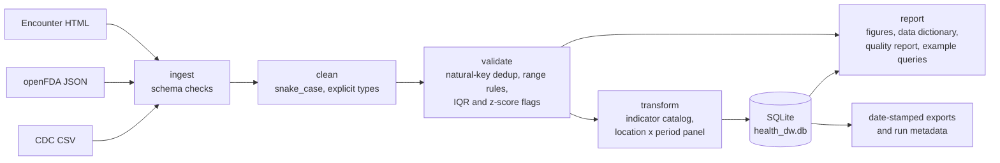
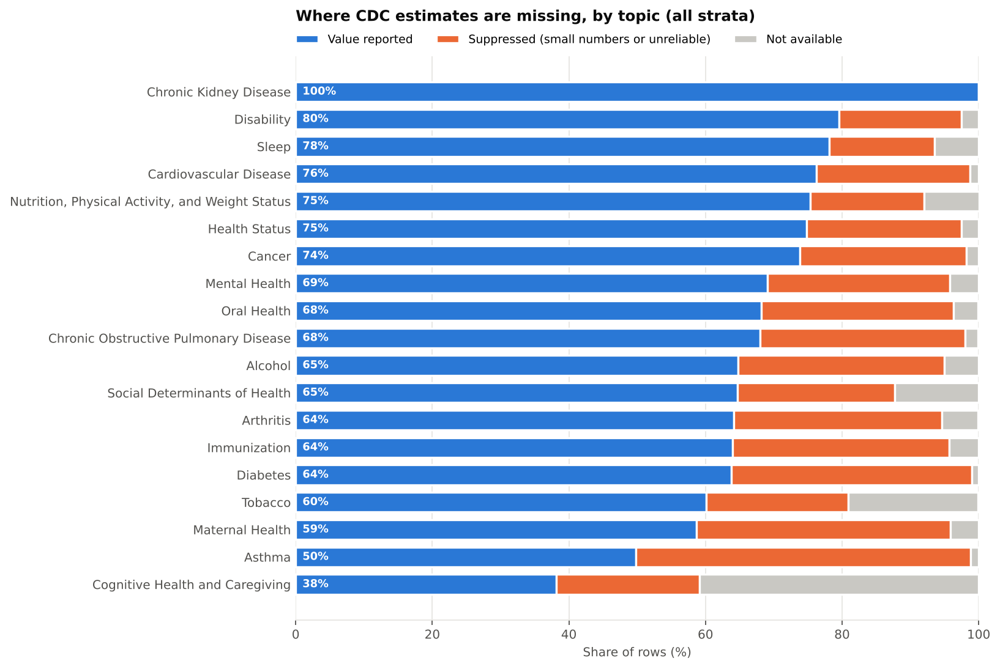
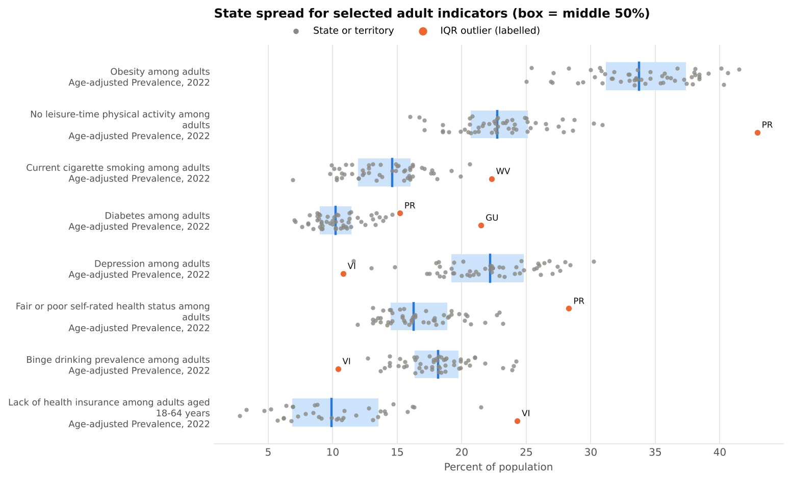
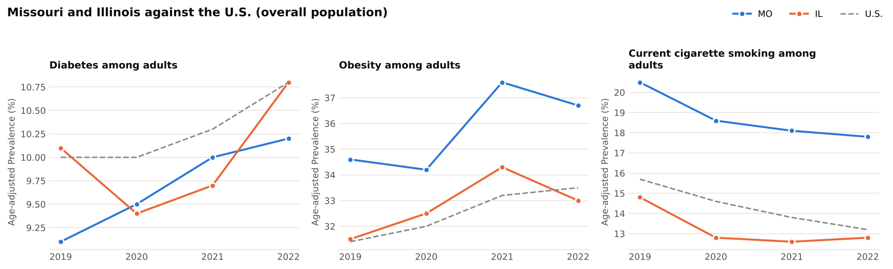

# Mini Health Data Warehouse

A small, tested Python pipeline that loads CDC chronic disease indicators, openFDA drug labels and a simulated encounter report into a documented SQLite warehouse, with data quality checks at every step.

[](https://github.com/rmali0/health-data-warehouse/actions/workflows/ci.yml)


## Why this project

Before graduate school I managed a clinic in Malawi, where monthly indicator reports went from paper registers and an EMR into DHIS2. Most of the work was not analysis. It was making sure a number meant the same thing every month: the same population, the same denominator, no double counting. This project applies that discipline to public U.S. data. The question is practical: can a state-by-year table of chronic disease indicators be built so that every cell is traceable to one well-defined estimate, and every dropped or flagged value is counted and explained?

## Data

| Source | Format | Size | Terms |
|---|---|---|---|
| [CDC U.S. Chronic Disease Indicators](https://data.cdc.gov/Chronic-Disease-Indicators/U-S-Chronic-Disease-Indicators/g4ie-h725) (dataset `g4ie-h725`) | CSV | 309,215 rows x 34 columns, about 100 MB | U.S. government data, public domain; cite CDC |
| [openFDA drug label API](https://open.fda.gov/apis/drug/label/) | JSON | 1 label (API sample) | [openFDA terms](https://open.fda.gov/terms/) |
| Simulated clinical encounters | HTML | 5 rows | Made up by me; no patient data |

The CDC file is not committed. `python scripts/download_cdc_cdi.py` fetches it, and a 4,256-row gzipped sample in `data/sample/` lets the tests and a demo run work without it. Provenance, checksums and how the sample was drawn are in [`data/README.md`](data/README.md).

## Approach



- **Ingest.** Each reader checks that the columns the pipeline relies on exist and fails with a clear message if not. The CDC file is read as text so that typing is explicit.
- **Clean.** Columns are converted to snake_case (`LocationAbbr` to `location_abbr`). Values such as `9,537` are parsed as numbers, not coerced to missing. Ten raw columns that are empty in this release are dropped and listed in the report. 9,680 question cells where a UTF-8 dash had been decoded as Windows-1252 (so "18-64" read as three junk characters between the numbers) are repaired.
- **Validate.** A CDC estimate is identified by period, location, source, indicator, value type and stratum. Duplicates are checked on that key. Negative values and percentages outside 0 to 100 are set to missing with a count; estimates outside their own 95% CI are reported. Outliers are flagged, not removed, using the 1.5 x IQR rule and |z| > 3 within groups of locations reporting the same measure for the same period and stratum.
- **Transform.** For each of the 109 indicators I pick one value type for the panel (age-adjusted first, since the panel is for comparing states) and record it in `indicator_catalog`. The panel has one row per location and reporting period and one column per indicator, named by its CDC code (`dia01`).
- **Load.** `sql/schema.sql` declares every table with keys and constraints, including a UNIQUE constraint on the CDC natural key. The database is rebuilt from scratch in one transaction on each run, and row counts are checked after loading.
- **Govern.** Every run writes `outputs/run_metadata.json` and an `etl_runs` row with input SHA-256 hashes, row counts and stage timings, plus date-stamped CSV exports in `data/processed/`.

### Warehouse schema

| Table | Grain | Rows (full run) |
|---|---|---|
| `cdc_raw_clean` | one CDC estimate (period x location x indicator x value type x stratum) | 309,215 |
| `cdc_indicators` | one location x reporting period; 109 indicator columns (overall population) | 583 |
| `indicator_catalog` | one indicator, with the value type used in the panel | 109 |
| `fda_drug_labels` | one openFDA label: curated fields plus the raw JSON | 1 |
| `clinical_encounters` | one simulated encounter | 5 |
| `etl_runs` | one pipeline run (lineage) | 1 |

Column definitions are in [`docs/data_dictionary.md`](docs/data_dictionary.md).

## Key results

All numbers below come from `python -m healthdw run` on the full CDC file (SHA-256 `a988e65e...`), as recorded in [`docs/data_quality_report.md`](docs/data_quality_report.md). The full run took 34 seconds in my build environment (Python 3.13, pandas 3.0).

**The main finding is about the pipeline itself.** Rebuilding the course version showed that its deduplication key (year, state, topic, question) ignored the stratum and value type, so it treated 293,903 of 309,215 rows (95%) as duplicates. They were not: on the full natural key there are no duplicates at all. The rows it kept were whichever stratum came first, so most "state" values in its panel were actually subgroup estimates.

| | Course version | This version |
|---|---|---|
| CDC rows kept after deduplication | 15,312 | 309,215 |
| Of those, overall-population estimates | 2,408 | 29,201 |
| Values with thousands separators lost to `to_numeric(errors="coerce")` | 293 (8,097 in the full file) | 0 |
| Indicator columns in the panel | 106 (3 pairs merged by 50-character name truncation) | 109 |
| Panel rows | 376 (state x start year, periods mixed) | 583 (state x reporting period) |
| Outlier rule | one IQR across all units (%, rates, counts) | IQR and z-score within comparable groups |

Of the 209,196 estimates with a value, 6,692 (3.2%) are IQR outliers within their comparison group and 1,867 have |z| > 3. Most missing values are CDC suppression of small subgroups, not gaps in collection:



The flagged outliers are mostly territories (Puerto Rico, Guam, the U.S. Virgin Islands) and a few states at the edge of the distribution, such as West Virginia for smoking. They look like real differences rather than data errors, which is why the pipeline flags them instead of dropping them.



Because the panel now holds one well-defined estimate per cell, simple comparisons are straightforward. This query from [`sql/example_queries.sql`](sql/example_queries.sql) reads the wide table:

```sql
SELECT year_start AS year,
       ROUND(MAX(CASE WHEN location_abbr = 'MO' THEN dia01 END), 1) AS missouri,
       ROUND(MAX(CASE WHEN location_abbr = 'IL' THEN dia01 END), 1) AS illinois,
       ROUND(MAX(CASE WHEN location_abbr = 'US' THEN dia01 END), 1) AS us
FROM cdc_indicators
WHERE year_start = year_end AND location_abbr IN ('MO', 'IL', 'US') AND dia01 IS NOT NULL
GROUP BY year_start ORDER BY year_start;
```

Diabetes among adults, age-adjusted prevalence (%):

| year | missouri | illinois | us |
|---|---|---|---|
| 2019 | 9.1 | 10.1 | 10.0 |
| 2020 | 9.5 | 9.4 | 10.0 |
| 2021 | 10.0 | 9.7 | 10.3 |
| 2022 | 10.2 | 10.8 | 10.8 |



Missouri's age-adjusted adult smoking (17.8% in 2022) and obesity (36.7%) stayed above the U.S. figures (13.2% and 33.5%) across all four years. The other five queries (top states for obesity with confidence intervals, the male minus female smoking gap, missingness by topic, outlier counts by location, sparse indicators) and their output are in [`docs/example_query_results.md`](docs/example_query_results.md). Panel coverage by topic and period is in [`outputs/figures/panel_coverage_heatmap.png`](outputs/figures/panel_coverage_heatmap.png).

## Limitations

- The panel holds overall-population estimates only. Stratified estimates stay in `cdc_raw_clean` and are queried there (as in the smoking gap query).
- Only 22.3% of panel cells are filled. Most gaps are structural: each indicator is published only for the periods its survey covers (for example cancer incidence as five-year periods, BRFSS modules in alternate years).
- Age-adjusted and crude values are not interchangeable. The panel uses one type per indicator, chosen by a fixed preference list; `indicator_catalog` records which.
- Outlier flags depend on the comparison group and the 1.5 x IQR and |z| > 3 thresholds. They point to values worth a second look; they are not error labels.
- The openFDA table holds one label and the encounter table five simulated rows. They demonstrate JSON and HTML ingestion; no conclusions should be drawn from them.
- CDC revises this dataset. A fresh download may give different counts than the ones above.
- The download scripts could not be tested against data.cdc.gov or api.fda.gov from the environment where I built this; the CDC script was tested end to end against a local copy of the file.

## How to run

Requires Python 3.11 or newer.

```bash
git clone https://github.com/rmali0/health-data-warehouse.git
cd health-data-warehouse
python -m pip install -e ".[dev]"

make all          # downloads the CDC file if missing (about 100 MB), then runs the full pipeline
make sample       # or: python -m healthdw run --sample   (bundled fixture, writes to build/sample/)
make queries      # runs sql/example_queries.sql against data/processed/health_dw.db
make test lint    # pytest and ruff
```

`python -m healthdw run` is the single entry point (`healthdw run` also works once installed). It rebuilds `data/processed/health_dw.db`, which is not committed, and regenerates everything under `outputs/` and `docs/`. Any SQLite client can open the database, for example `sqlite3 data/processed/health_dw.db ".tables"`.

## Repository layout

```
health-data-warehouse/
├── src/healthdw/          # package: config, ingest, clean, validate, transform, load, figures, report, pipeline, cli
├── sql/
│   ├── schema.sql         # DDL for the warehouse
│   └── example_queries.sql
├── scripts/
│   ├── download_cdc_cdi.py
│   ├── fetch_openfda_labels.py
│   └── make_sample.py     # rebuilds data/sample from the full file
├── data/
│   ├── README.md          # provenance and checksums
│   ├── raw/               # openFDA JSON, simulated encounters HTML (CDC CSV downloaded here)
│   └── sample/            # cdc_cdi_sample.csv.gz (4,256 rows)
├── outputs/
│   ├── figures/           # PNG figures from the full run
│   ├── tables/            # summary CSVs, indicator catalog, data dictionary, wide panel
│   └── run_metadata.json
├── docs/                  # data quality report, data dictionary, example query results
├── tests/                 # pytest suite (36 tests)
├── .github/workflows/ci.yml
├── Makefile
└── pyproject.toml
```

## Course context and what changed

I originally built this as my individual final project for ORES-5160 (Data Management) at Saint Louis University in Fall 2025, as a single Google Colab notebook reading from Google Drive. This repository is a cleaned-up portfolio version. It keeps the design (multi-format ingestion, snake_case normalization, layered validation, a long-to-wide state panel, a four-table SQLite load, quality figures, a data dictionary, versioned exports) and changes the following:

- **Deduplication key fixed.** The course key dropped 293,903 distinct stratified estimates (95% of the file). The natural key now includes period end, data source, value type and stratum, and finds no duplicates. The database enforces it with a UNIQUE constraint.
- **Numeric parsing fixed.** Counts written with thousands separators were silently coerced to missing; they are now parsed.
- **Panel definition fixed.** The panel used to be keyed on start year only and filled from whichever stratum and value type survived deduplication. It now uses overall-population estimates, one documented value type per indicator, and a (start year, end year) period.
- **Column naming fixed.** Indicator columns were built from truncated topic and question text, which merged three pairs of indicators by averaging. Columns are now named by CDC code, with the text in `indicator_catalog`.
- **Outlier detection fixed.** A single IQR across percentages, rates and counts is replaced by IQR and z-score flags within comparable groups, excluding the national row.
- **Range check fixed.** The percentage check looked for columns whose names contained "percent" or "rate", matched none, and never ran. It now applies to rows whose unit is %.
- **Figures fixed.** The missingness heatmap used only the first 200 rows and the histograms included the year column. Figures now use the full tables. The pipeline DAG image is replaced by the Mermaid diagram above.
- **Data dictionary fixed.** Statistics were computed on `head(10000)` and `head(1000)` samples; they now use the full tables and include column descriptions.
- **Engineering.** Removed Colab and Drive mounting, the interactive upload fallback, glob-based file renaming, and `pip install` calls inside the code. Replaced broad `try/except` blocks that printed and continued with explicit errors. Split the notebook into a package with a CLI, explicit SQL DDL, a stdlib download script, 36 pytest tests and CI on Python 3.11 and 3.12.
- **Scope trimmed.** The generated Word and PDF executive summary is replaced by a data quality report generated from the run, so every number in it comes from the data.

## Author

Richard Mali, MS Health Data Science student, Saint Louis University. [LinkedIn](https://linkedin.com/in/richardmali)

I used Claude as a coding assistant for refactoring and testing; analysis decisions and interpretation are mine.
